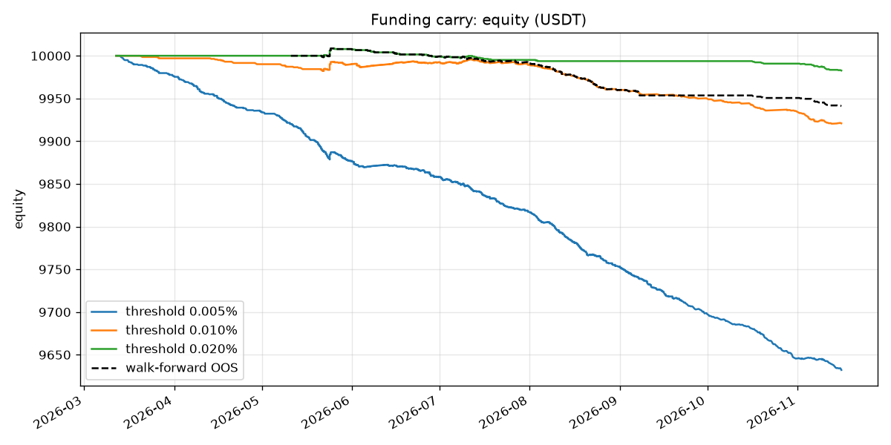

# Funding carry backtest

Generated 2026-11-23 08:49 UTC. Data: 10 symbols, 6,255 funding events, 2026-03-12 → 2026-11-23.

Capital 10,000 USDT, 10 slots × 1,000 USDT, leg notional 500 USDT, leverage 1x. Cost per fill 0.075% (taker 0.055% + spread 0.020%), round trip 0.30% of leg notional. Signal: mean of last 3 settled rates.

## Threshold comparison (full sample, in-sample)

| threshold / interval | APR | max DD | exposure days | slot util. | trades | funding PnL | costs | net PnL |
|---|---|---|---|---|---|---|---|---|
| 0.005% | **-3.93%** | -2.76% | 94.2% | 10.4% | 275 | 136.46 | 412.50 | -276.04 |
| 0.010% | **-0.73%** | -0.51% | 78.2% | 6.1% | 106 | 107.70 | 159.00 | -51.30 |
| 0.020% | **-0.36%** | -0.34% | 30.0% | 0.7% | 39 | 33.26 | 58.50 | -25.24 |

## Per-symbol breakdown (threshold 0.020%)

| symbol | events | trades | held ratio | mean rate | funding PnL | costs | net PnL | APR on slot |
|---|---|---|---|---|---|---|---|---|
| BTCUSDT | 770 | 0 | 0.0% | 0.0024% | 0.00 | 0.00 | 0.00 | 0.00% |
| DOGEUSDT | 770 | 0 | 0.0% | 0.0028% | 0.00 | 0.00 | 0.00 | 0.00% |
| ETHUSDT | 770 | 0 | 0.0% | 0.0020% | 0.00 | 0.00 | 0.00 | 0.00% |
| SOLUSDT | 770 | 0 | 0.0% | 0.0004% | 0.00 | 0.00 | 0.00 | 0.00% |
| ZECUSDT | 770 | 1 | 0.9% | -0.0002% | 1.31 | 1.50 | -0.19 | -0.03% |
| SOXSUSDT | 478 | 1 | 0.6% | -0.0014% | 0.00 | 1.50 | -1.50 | -0.34% |
| QQQUSDT | 246 | 4 | 4.5% | 0.0023% | 0.69 | 6.00 | -5.31 | -2.37% |
| PIEVERSEUSDT | 540 | 10 | 11.3% | 0.0129% | 9.19 | 15.00 | -5.81 | -1.18% |
| SOXLUSDT | 579 | 14 | 9.5% | 0.0132% | 15.16 | 21.00 | -5.84 | -1.11% |
| EVAAUSDT | 562 | 9 | 8.7% | 0.0126% | 6.90 | 13.50 | -6.60 | -1.29% |

## Walk-forward (out-of-sample)

Train 60d → test 30d, step 30d. Stitched OOS: **APR -0.88%**, max DD -0.56%, exposure days 54.3%, trades 70, net PnL -47.53 USDT over 196 days.

| train start | train end | test end | chosen threshold | train APR | test APR | test max DD | test trades |
|---|---|---|---|---|---|---|---|
| 2026-03-12 | 2026-05-11 | 2026-06-10 | 0.020% | 0.00% | 0.49% | -0.05% | 5 |
| 2026-04-11 | 2026-06-10 | 2026-07-10 | 0.020% | 0.24% | -0.75% | -0.07% | 8 |
| 2026-05-11 | 2026-07-10 | 2026-08-09 | 0.010% | 0.37% | -1.17% | -0.10% | 16 |
| 2026-06-10 | 2026-08-09 | 2026-09-08 | 0.010% | -0.08% | -2.24% | -0.18% | 25 |
| 2026-07-10 | 2026-09-08 | 2026-10-08 | 0.020% | -0.56% | -0.37% | -0.03% | 3 |
| 2026-08-09 | 2026-10-08 | 2026-11-07 | 0.020% | -0.36% | -0.84% | -0.07% | 5 |
| 2026-09-08 | 2026-11-07 | 2026-11-23 | 0.020% | -0.60% | -1.76% | -0.07% | 8 |

## Assumptions

- Spot long and perp short are equal notional; basis / mark-to-market between legs is assumed to net to zero.
- Funding PnL = leg notional × funding rate for every settlement while in position (short receives positive rates).
- Notional is fixed per slot (no compounding); APR = net PnL / capital × 365 / days.
- Signal uses only settled rates (no look-ahead). A position open at the end of the sample is closed and charged exit costs.
