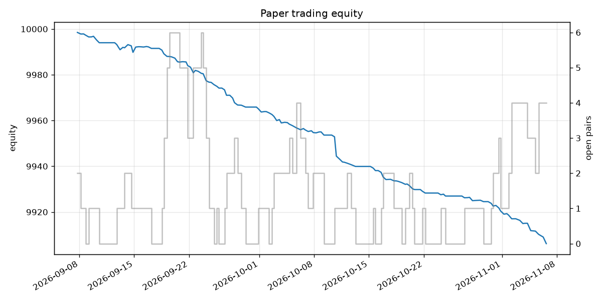

# Paper trading status

Run #190 at 2026-11-12 16:45 UTC. Threshold 0.010% per funding interval, signal = mean of last 3 settled rates. Universe: BTCUSDT, ETHUSDT, SOLUSDT, SOXLUSDT, ZECUSDT, SOXSUSDT, DOGEUSDT, XRPUSDT, MUUSDT, QQQUSDT.

| metric | value |
|---|---|
| equity | 9,902.93 USDT |
| return since start | -0.97% (66.0 days) |
| annualised | -5.37% |
| realized (closed pairs) | -97.07 USDT |
| funding received this run | 0.0000 USDT |
| open pairs | 0 / 10 |
| free cash | 9,902.93 USDT |
| skipped symbols | 0 |

## Positions & risk

| symbol | held | action | signal | mark | spot | funding accrued | basis MTM | margin ratio | liq. price | liq. distance |
|---|---|---|---|---|---|---|---|---|---|---|
| BTCUSDT | no |  | 0.0073% | 71,542.2800 | 71,567.1000 | - | - | - | - | - |
| DOGEUSDT | no |  | 0.0061% | 0.0655 | 0.0655 | - | - | - | - | - |
| ETHUSDT | no |  | 0.0028% | 1,999.7100 | 2,000.4800 | - | - | - | - | - |
| MUUSDT | no |  | 0.0000% | 786.0800 | 786.2200 | - | - | - | - | - |
| QQQUSDT | no | CLOSE | 0.0000% | 690.9400 | 691.1200 | - | - | - | - | - |
| SOLUSDT | no |  | 0.0043% | 81.1000 | 81.1400 | - | - | - | - | - |
| SOXLUSDT | no |  | 0.0000% | 65.1600 | 65.2700 | - | - | - | - | - |
| SOXSUSDT | no |  | 0.0000% | 46.0400 | 46.0300 | - | - | - | - | - |
| XRPUSDT | no |  | 0.0059% | 1.0205 | 1.0213 | - | - | - | - | - |
| ZECUSDT | no |  | -0.0051% | 946.6700 | 946.5000 | - | - | - | - | - |

_Margin ratio = maintenance margin / (margin + unrealized) on the isolated perp short; ≥100% means liquidation. Liq. distance = how far mark must rise before liquidation._
