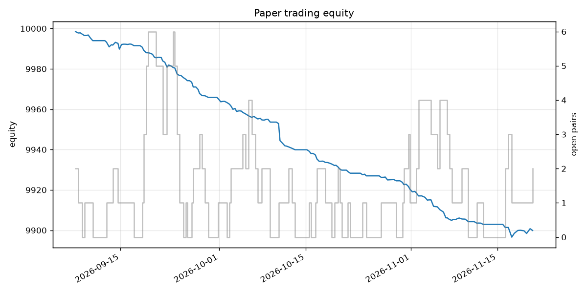

# Paper trading status

Run #203 at 2026-11-18 07:14 UTC. Threshold 0.010% per funding interval, signal = mean of last 3 settled rates. Universe: BTCUSDT, ETHUSDT, SOLUSDT, SOXLUSDT, SOXSUSDT, ZECUSDT, DOGEUSDT, QQQUSDT, SNXXUSDT, MUUSDT.

| metric | value |
|---|---|
| equity | 9,899.90 USDT |
| return since start | -1.00% (71.6 days) |
| annualised | -5.11% |
| realized (closed pairs) | -100.48 USDT |
| funding received this run | 0.1215 USDT |
| open pairs | 1 / 10 |
| free cash | 8,899.52 USDT |
| skipped symbols | 0 |

## Positions & risk

| symbol | held | action | signal | mark | spot | funding accrued | basis MTM | margin ratio | liq. price | liq. distance |
|---|---|---|---|---|---|---|---|---|---|---|
| EVAAUSDT | yes |  | 0.0142% | 3.7363 | 3.7402 | 0.7282 | 0.4104 | 1.00% | 5.5692 | 49.1% |
| BTCUSDT | no |  | -0.0007% | 64,752.6000 | 64,781.4000 | - | - | - | - | - |
| DOGEUSDT | no |  | -0.0051% | 0.0596 | 0.0596 | - | - | - | - | - |
| ETHUSDT | no |  | -0.0003% | 1,817.1900 | 1,818.0600 | - | - | - | - | - |
| MUUSDT | no |  | 0.0041% | 734.7600 | 734.6900 | - | - | - | - | - |
| QQQUSDT | no |  | 0.0000% | 662.2900 | 662.2500 | - | - | - | - | - |
| SNXXUSDT | no |  | 0.0026% | 3.0550 | 3.0560 | - | - | - | - | - |
| SOLUSDT | no |  | -0.0109% | 75.1700 | 75.2100 | - | - | - | - | - |
| SOXLUSDT | no |  | 0.0000% | 52.0500 | 52.0700 | - | - | - | - | - |
| SOXSUSDT | no |  | 0.0000% | 55.2300 | 55.2000 | - | - | - | - | - |
| ZECUSDT | no |  | -0.0019% | 957.5800 | 958.1200 | - | - | - | - | - |

_Margin ratio = maintenance margin / (margin + unrealized) on the isolated perp short; ≥100% means liquidation. Liq. distance = how far mark must rise before liquidation._
