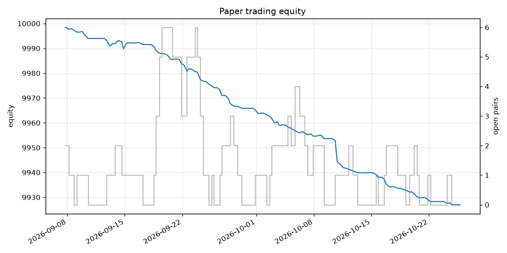

# Paper trading status

Run #109 at 2026-10-14 20:09 UTC. Threshold 0.010% per funding interval, signal = mean of last 3 settled rates. Universe: BTCUSDT, ETHUSDT, SOLUSDT, ZECUSDT, XRPUSDT, SOXLUSDT, NEARUSDT, DOGEUSDT, SPCXUSDT, BNBUSDT.

| metric | value |
|---|---|
| equity | 9,939.91 USDT |
| return since start | -0.60% (37.1 days) |
| annualised | -5.91% |
| realized (closed pairs) | -60.09 USDT |
| funding received this run | 0.0000 USDT |
| open pairs | 0 / 10 |
| free cash | 9,939.91 USDT |
| skipped symbols | 0 |

## Positions & risk

| symbol | held | action | signal | mark | spot | funding accrued | basis MTM | margin ratio | liq. price | liq. distance |
|---|---|---|---|---|---|---|---|---|---|---|
| BNBUSDT | no |  | 0.0080% | 729.8500 | 730.1000 | - | - | - | - | - |
| BTCUSDT | no |  | 0.0039% | 81,897.0000 | 81,921.9000 | - | - | - | - | - |
| DOGEUSDT | no |  | 0.0036% | 0.0822 | 0.0822 | - | - | - | - | - |
| ETHUSDT | no |  | 0.0026% | 2,433.0200 | 2,433.9400 | - | - | - | - | - |
| NEARUSDT | no |  | 0.0061% | 4.8231 | 4.8230 | - | - | - | - | - |
| SOLUSDT | no |  | 0.0016% | 104.3600 | 104.4200 | - | - | - | - | - |
| SOXLUSDT | no |  | 0.0000% | 110.2900 | 110.3100 | - | - | - | - | - |
| SPCXUSDT | no |  | 0.0006% | 152.1700 | 148.3000 | - | - | - | - | - |
| XRPUSDT | no |  | -0.0030% | 1.3279 | 1.3287 | - | - | - | - | - |
| ZECUSDT | no |  | 0.0078% | 1,157.7100 | 1,157.9100 | - | - | - | - | - |

_Margin ratio = maintenance margin / (margin + unrealized) on the isolated perp short; ≥100% means liquidation. Liq. distance = how far mark must rise before liquidation._
